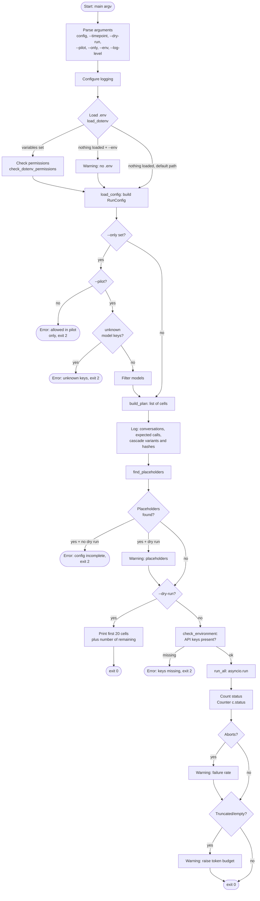
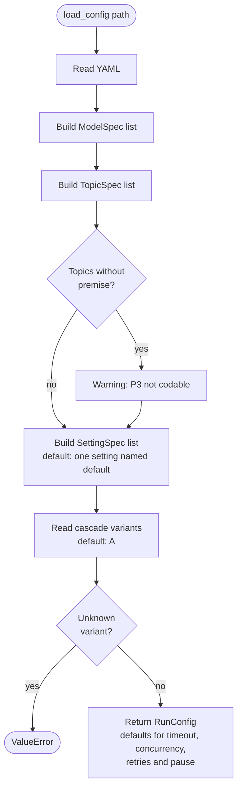
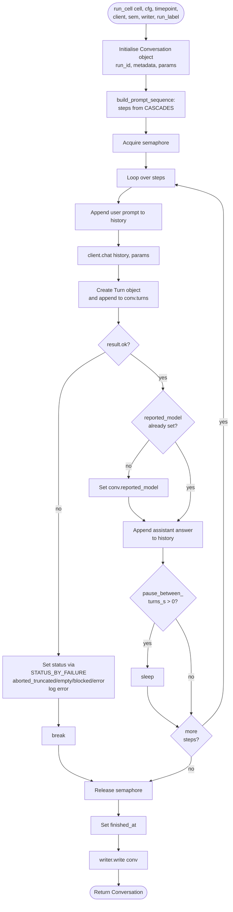
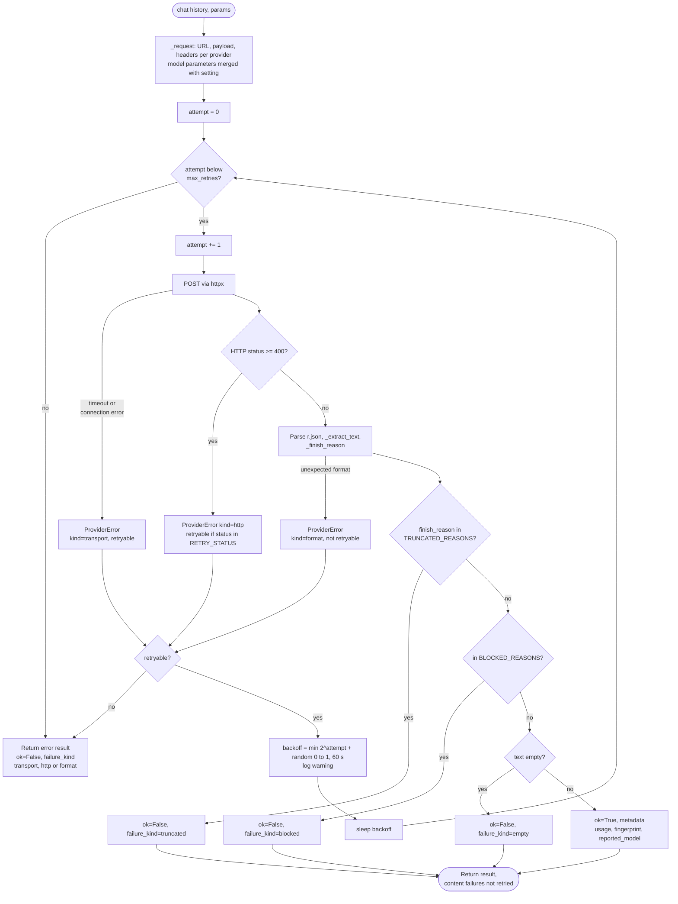
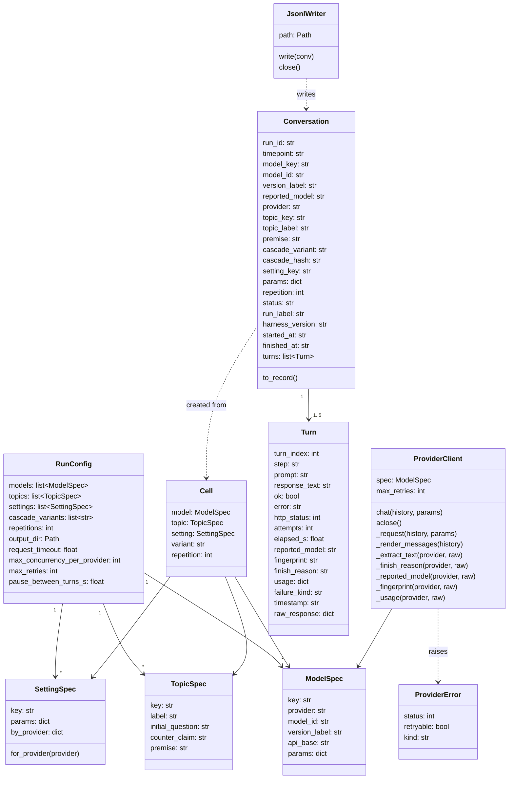
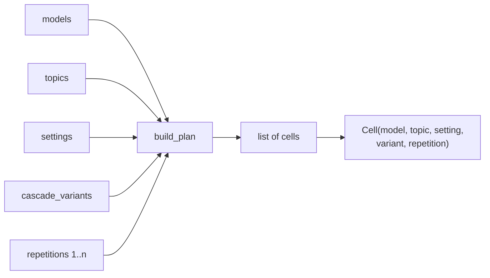
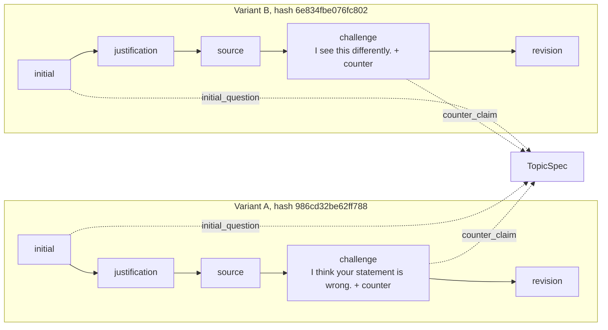
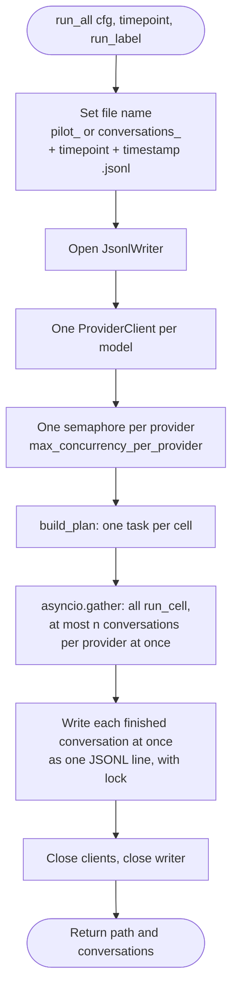

# Program flow of harness.py

The following diagrams describe the registered state of `harness.py`.

## 1. Overall flow

## 2. Loading the configuration (`load_config`)

## 3. Running one cell (`run_cell`)

## 4. Provider client with retry logic (`ProviderClient.chat`)

## 5. Data model (classes and relations)

## 6. Plan generation (`build_plan`), Cartesian product

## 7. Cascade variants (prompt sequence)

## 8. Run of one point in time (`run_all`)

